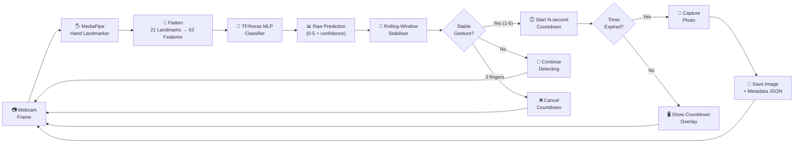

# Gesture-to-Camera-Control Pipeline

This diagram shows how the system processes each webcam frame from raw input to
camera capture.

## Component Details

| Stage | Technology | Details |
|-------|-----------|---------|
| Hand Detection | MediaPipe Hand Landmarker | float16 model, 0.35 min confidence |
| Feature Extraction | NumPy | 21 landmarks × 3 coords (x, y, z) = 63 features |
| Classification | TensorFlow / Keras | MLP: 128 → 64 → 32 → 6 (softmax), ~260 KB |
| Stabilisation | Rolling Window Vote | 8-frame window, min 4 votes, 55% confidence threshold |
| Camera Control | OpenCV | Countdown timer → auto-capture with flash effect |
